<p align="center">
  
</p>

<h1 align="center">StockRun</h1>

<p align="center">
  <strong>An AI buying agent for Lagos. Find real sellers near you, agree a price on WhatsApp,<br />
  and pay only for the goods you actually collect.</strong><br />
  Every payment decision is made by a TapeOut circuit on X Layer, never by the AI.
</p>

<p align="center">
  <a href="https://stockrun-ai.duckdns.org"><strong>Live app → stockrun-ai.duckdns.org</strong></a>
  &nbsp;·&nbsp; <a href="#"><strong>Demo video (coming soon)</strong></a><!-- TODO: replace # with the video link -->
  &nbsp;·&nbsp; Built for the X Layer × TapeOut "Build X" hackathon
  &nbsp;·&nbsp; Naira runs in Paystack <strong>test mode</strong>: no real money moves
</p>

| TapeOut on X Layer mainnet (chain 196) | |
| --- | --- |
| **Processor contract** | [`0x34efCc0a3191A48Feec787252E6d817b063A4017`](https://www.oklink.com/xlayer/address/0x34efCc0a3191A48Feec787252E6d817b063A4017) |
| **Circuit ID 1**: RestockGuard (may the money lock?) | tapeout tx [`0xaf6429bf…d2a0feca6fd`](https://www.oklink.com/xlayer/tx/0xaf6429bf2e4a7bc4e435ca493815b8b868d7728389ed904e5eb0dd2a0feca6fd) |
| **Circuit ID 2**: PickupCheck (how much is the seller paid?) | tapeout tx [`0x24b80f4d…38bacae`](https://www.oklink.com/xlayer/tx/0x24b80f4d29c57371c33357cd9b9ece03038d9016ade3e296620747c5e18bacae) |
| **Circuit ID 3**: DeliveryCheck (did everything arrive? recorded, no money moves) | tapeout tx [`0x0249042e…e86d66d2`](https://www.oklink.com/xlayer/tx/0x0249042e8918f77cbe4056880fc10a0d54ab3bdb4599f47fe66fa313e86d66d2) |
| **Transistor token** (NAND) | [`0xe63af1B06D02Bb1B44741C0459d4083ec5b440d4`](https://www.oklink.com/xlayer/address/0xe63af1B06D02Bb1B44741C0459d4083ec5b440d4) |

Details: [TapeOut on X Layer](#tapeout-on-x-layer). Check any order yourself: [Verify a decision](#verify-a-decision).

**If StockRun holds the naira, what do the circuits add?**
- **The rules are public and can't be changed.** The processor is frozen, so nobody, StockRun included, can edit how
  payments are decided.
- **Every decision can be re-checked.** Each order saves its circuit input, output and block number, so anyone can call
  `eval` again and confirm it. One command does it: `node scripts/verify-order.mjs <orderId>`.
- **Even the admin is bound.** Only a circuit decision moves locked money. An admin can send an approved payout, but
  can't create, change or redirect one.
- **Coins don't need StockRun at all.** A buyer who pays in USD₮0 uses their own vault contract on X Layer, which
  calls the same circuits and moves the coins itself. StockRun can't touch them.

<p align="center">
  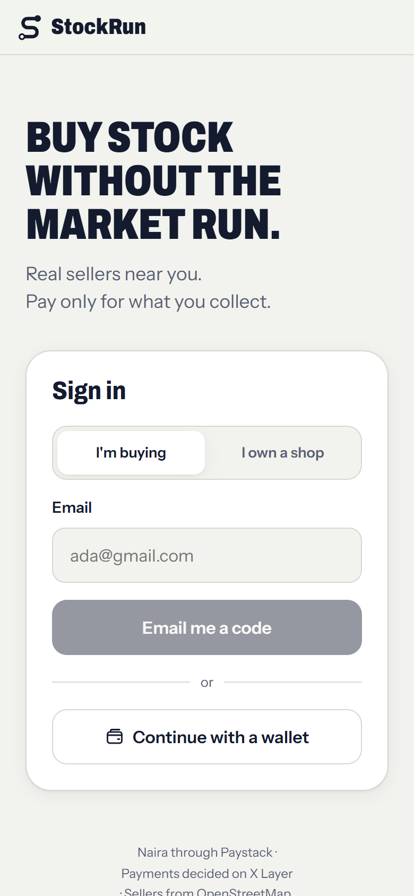
</p>

---

## The problem: buying stock in Lagos costs a day and carries all the risk

A shop owner in Ketu who needs 20 cartons of noodles has two choices today. Both are bad.

**1. Go to the market yourself.** Most food in Lagos is still bought in open markets such as Mile 12, Oyingbo and
Idumota: about **70% of food shopping happens in traditional open markets** [[1]](#sources). Getting there means
Lagos traffic. One estimate puts it at **about 1,080 hours a year in traffic** for a Lagos resident, against 148 in
London [[2]](#sources), and congestion costs the state an estimated **₦4 trillion a year** [[3]](#sources). For a small
trader, a restocking trip is half a working day with the shop closed.

**2. Order from a seller you found online, and pay first.** The seller wants the money before the goods leave, and
scams are common. In Visa's Stay Secure study, **51% of Nigerian consumers had experienced a financial scam in the past
12 months**, and **57%** of those scams happened on social media [[4]](#sources). That's why **around 60% of
Nigerian online shoppers prefer pay-on-delivery** to sharing card details [[5]](#sources). Even an honest seller can
send 18 cartons instead of 20, and once you've paid, getting the difference back is your problem.

All of this happens while prices keep rising: **food inflation was above 20% from February to August 2025** [[6]](#sources),
so every naira lost to a wasted trip, a short delivery or a fake seller hurts.

## The solution: StockRun

StockRun is a buying agent that you talk to like a person. You tell it what you need, your budget and your area. It
then does three things:

| | What StockRun does | Why it matters |
| --- | --- | --- |
| 🔎 | **Finds real sellers near you.** The AI works out what kind of seller sells your goods (bulk → wholesalers, small orders → supermarkets) and returns the closest real businesses that list a WhatsApp number. | No trip to the market just to find stock and prices. |
| 💬 | **Writes your first WhatsApp message.** One tap opens *your own* WhatsApp chat with the seller, message already typed. | You negotiate directly, the way Lagos already trades. StockRun sends nothing. |
| 🔒 | **Locks your money instead of paying the seller.** When you agree a price, your money is locked, not sent. The seller is paid **only for the goods counted at collection**; anything short comes back to you. | The seller knows the money is there; you never pay for goods you didn't get. |

The rule that makes this trustworthy: **the AI never moves money.** Each payment decision is made by one of three
small logic circuits that were burned onto X Layer with TapeOut. Nobody can change their rules, and the AI can't either.

---

## How it works, screen by screen

### 1. Ask for what you need

<table>
  <tr>
    <td width="33%" valign="top">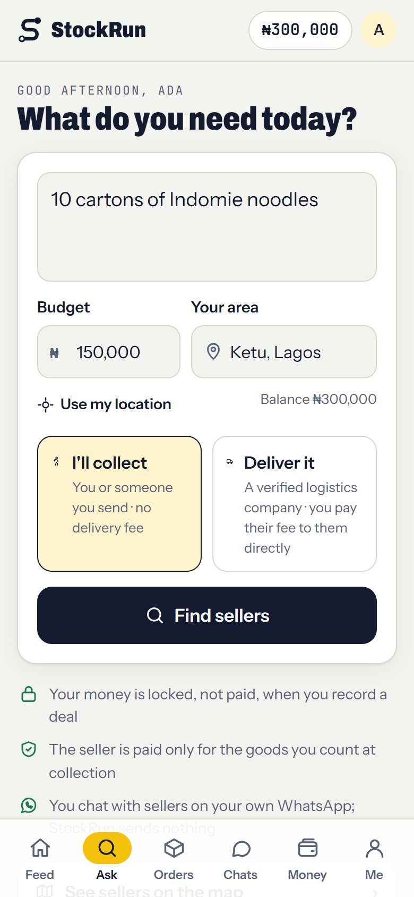</td>
    <td valign="top">
      <p>Sign in with an email code or a crypto wallet, add naira with Paystack, and type what you want in plain words:
      <em>"10 cartons of Indomie noodles"</em>, a budget, and your area. One word like <em>Ketu</em> is enough.</p>
      <p>Choose to collect it yourself (or send someone). Delivery by a logistics company appears here only when one is
      connected; on the live site you collect. If you choose delivery, you pay the delivery fee to the logistics company
      directly: StockRun never holds it.</p>
    </td>
  </tr>
</table>

### 2. The AI finds sellers near you

<table>
  <tr>
    <td width="33%" valign="top">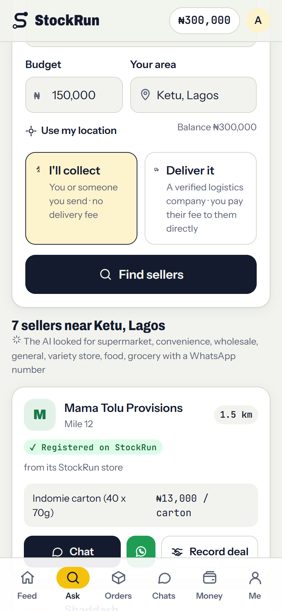</td>
    <td valign="top">
      <p>The AI decides which kinds of shop to search (here: wholesale, supermarket, grocery, convenience, general) and
      finds the closest ones with a WhatsApp number, sorted by distance.</p>
      <p>Sellers come from <strong>OpenStreetMap</strong> and from stores that registered on StockRun. Found sellers are
      clearly labelled <em>"Found by AI · not checked"</em>, with a link to where they were found.</p>
    </td>
  </tr>
</table>

### 3. Message the seller on your own WhatsApp

<table>
  <tr>
    <td width="33%" valign="top">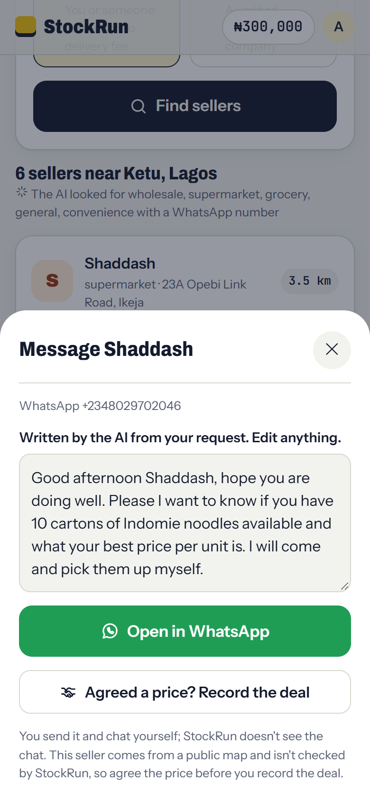</td>
    <td valign="top">
      <p>The AI writes a polite first message from your request, <strong>without your budget</strong>, so you don't
      negotiate against yourself. You can edit it, then <em>Open in WhatsApp</em> starts the chat from your own number.</p>
      <p>StockRun never sees the chat and never sends messages for you.</p>
    </td>
  </tr>
</table>

### 4. Record the deal: the money locks, it isn't paid

<table>
  <tr>
    <td width="33%" valign="top">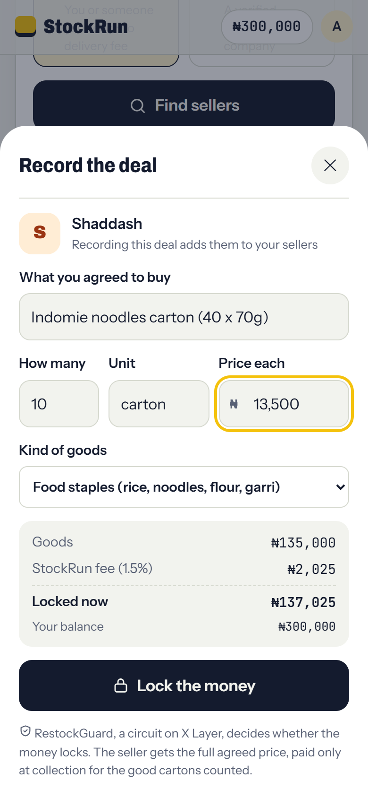</td>
    <td width="33%" valign="top">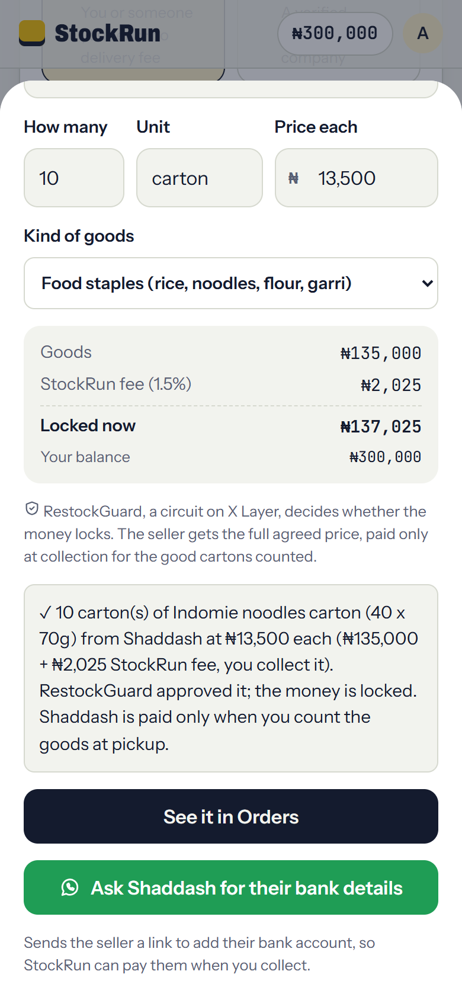</td>
    <td valign="top">
      <p>When you've agreed a price, record it: what, how many, price each. The receipt shows exactly what will be
      locked, including StockRun's 1.5% fee.</p>
      <p><strong>RestockGuard</strong> (circuit #1) decides: lock the money, ask you first (far away, alcohol,
      electronics, over your limit), or reject it with nothing charged.</p>
      <p>A link lets the seller add their bank account so StockRun can pay them at collection.</p>
    </td>
  </tr>
</table>

### 5. Collect, count, and the circuit pays for what you counted

<table>
  <tr>
    <td width="33%" valign="top">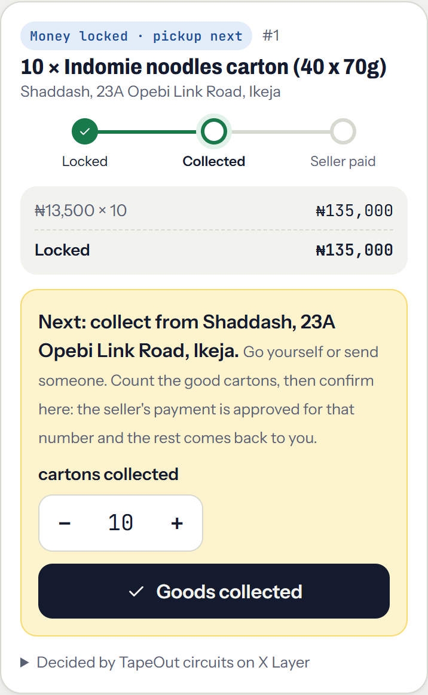</td>
    <td width="33%" valign="top">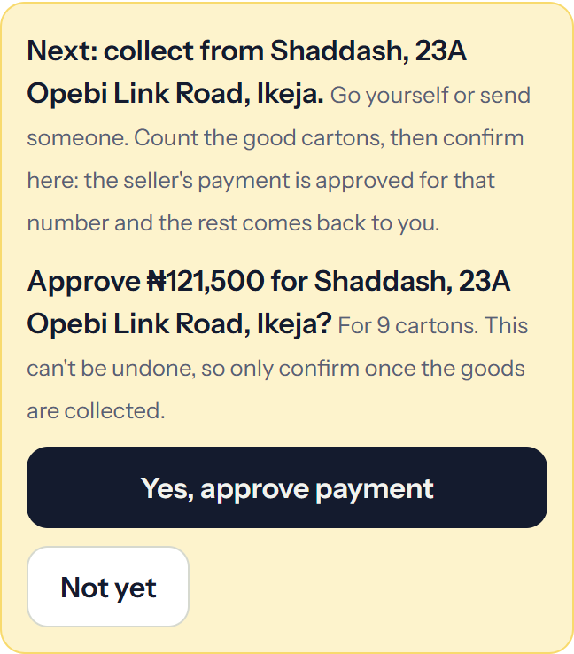</td>
    <td width="33%" valign="top">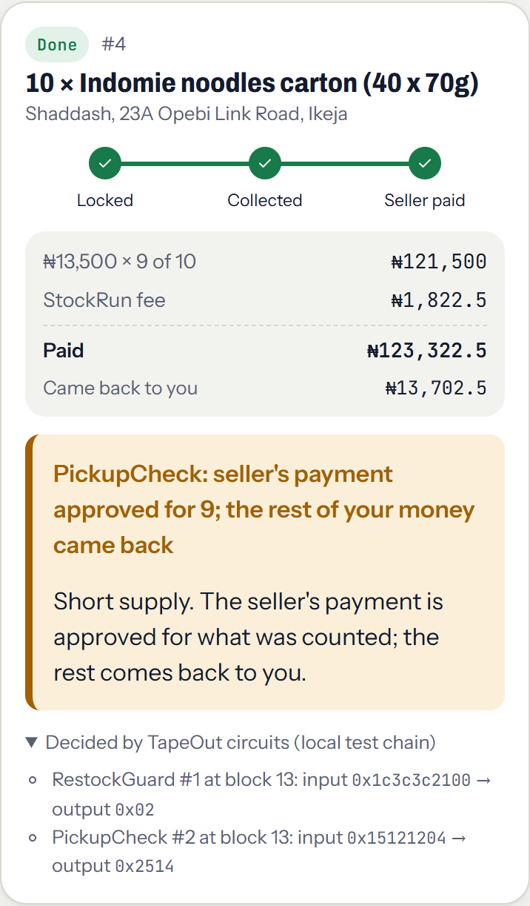</td>
  </tr>
</table>

Each order shows where it is: **Locked → Collected → Seller paid**. You (or someone you send) collect the goods and
count them. Here the seller handed over **9 of the 10** cartons. **PickupCheck** (circuit #2) approved the seller's
payment for 9, and the money for the 10th, with its share of the fee, came straight back.

Under every order, *"Decided by TapeOut circuits"* lists each circuit's input, output and block number, so anyone
can ask the circuit again and check the decision.

### 6. Your money, always visible

<table>
  <tr>
    <td width="33%" valign="top">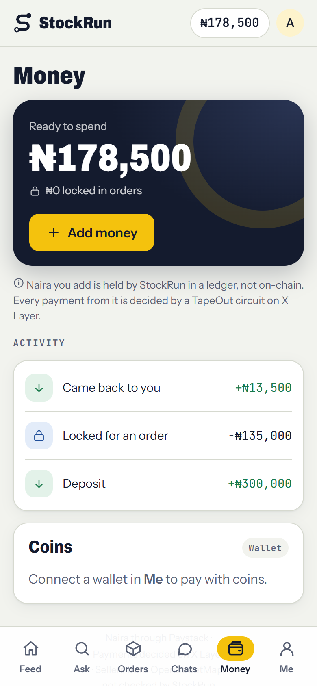</td>
    <td width="33%" valign="top">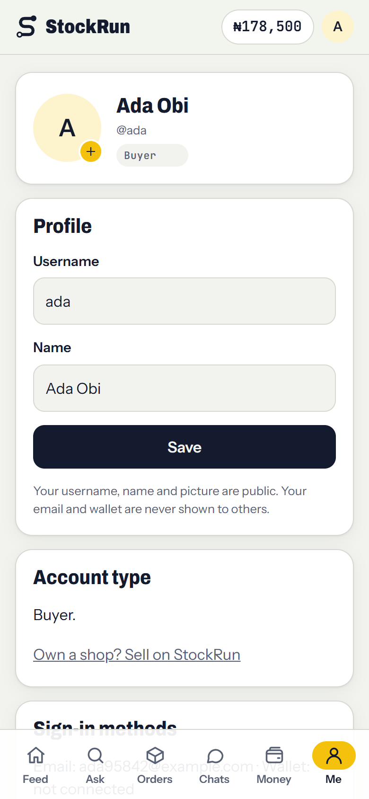</td>
    <td valign="top">
      <p><strong>Money</strong> shows what's ready to spend, what's locked in orders, and every movement. Withdraw to
      any Nigerian bank through Paystack.</p>
      <p><strong>Me</strong> holds your profile. Shop owners can also register their store (₦1,000 a month, after
      admin approval) so buyers find them and chat in the app.</p>
    </td>
  </tr>
</table>

### 7. The feed: stores post their stock, buyers message them

<table>
  <tr>
    <td width="33%" valign="top">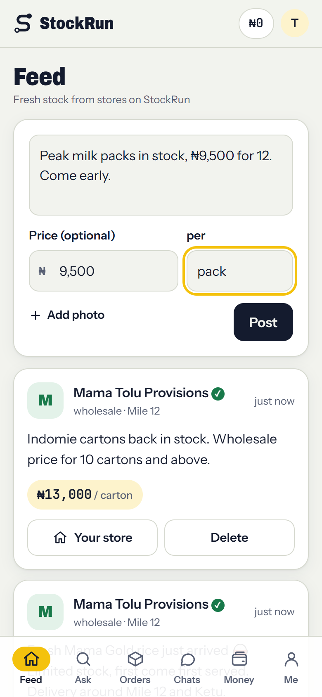</td>
    <td width="33%" valign="top">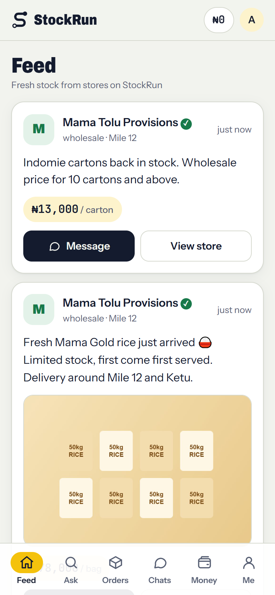</td>
    <td width="33%" valign="top">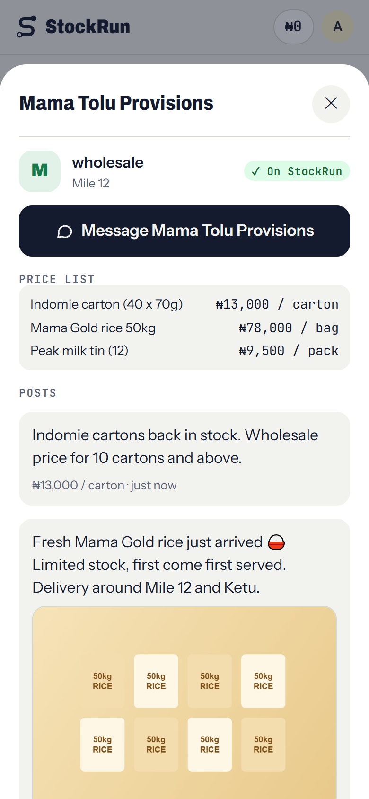</td>
  </tr>
  <tr>
    <td width="33%" valign="top">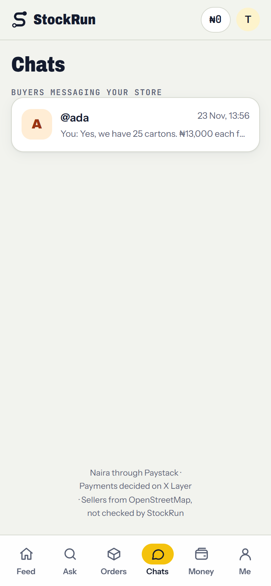</td>
    <td width="33%" valign="top">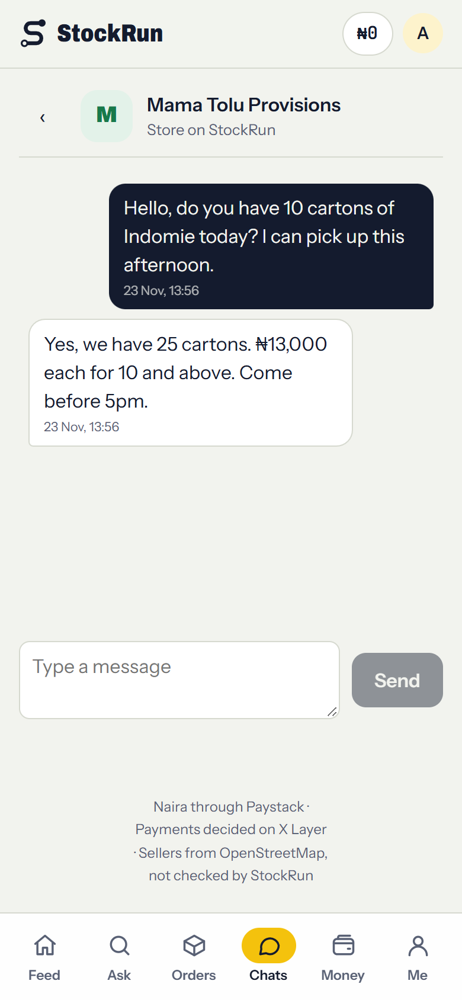</td>
    <td valign="top">
      <p>Shop owners whose store is <strong>approved and paid up</strong> post what's in stock: a few words, an optional
      price and a photo. Every buyer sees new posts in the <strong>Feed</strong>.</p>
      <p>Tapping a store opens its page with its price list and posts. <strong>Message</strong> starts an in-app chat,
      and the shop owner sees it under <em>"Buyers messaging your store"</em>.</p>
      <p>A store that stops paying, or is suspended, drops off the feed straight away.</p>
    </td>
  </tr>
</table>

---

## Who decides what

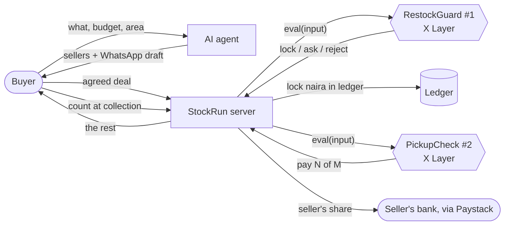

- **The AI** reads requests, picks the kind of seller, finds sellers and writes messages. It can't lock, pay or refund.
- **The circuits** decide every payment. Their inputs are built from stored order state and the buyer's signed-in
  confirmation, never from what a caller sends. If a circuit call fails, the order holds. It never pays by default.
- **The buyer's approval** can clear an "ask the buyer first" decision, but never a "reject".

### Delivery fees are paid outside StockRun

When a logistics company delivers, the buyer pays its delivery fee to the company directly. StockRun never holds it:

- **An order locks goods money only** (plus StockRun's 1.5% fee). RestockGuard checks that amount against the budget,
  with no delivery fee added.
- **The seller is paid at pickup**, as before, for what the handler counted.
- **DeliveryCheck (#3) records the outcome and moves no money.** It records "delivered in full" or "N short". The vault
  stores the verdict on the order and emits `DeliveryRecorded`; for naira orders it's saved with the order's circuit
  evidence. A short record is the buyer's proof for a claim against the logistics company.
- **Tests prove it.** `test_deliverySettlement_neverTransfersFunds` (vault) and "delivery settlement never moves
  money, for every verdict" (naira ledger) check that settling a delivery makes no transfer and changes no balance,
  whether it's delivered in full, short or waiting.

## What is on-chain and what isn't

| | Where it lives | Who can move it |
| --- | --- | --- |
| The three circuits' rules | X Layer, taped out (fixed NAND netlists; the processor is frozen) | Nobody can change them |
| Each payment decision | Asked of the circuit with `eval` on X Layer (read-only; no gas, no wallet). The input, output, circuit ID and block are saved with the order, so anyone can ask the circuit again and check | — |
| Naira balances and locked money | **StockRun's double-entry ledger** (integer kobo), backed by StockRun's Paystack account. **Not on-chain.** | Only circuit decisions move locked money; an admin can send approved payouts but can't create, change or redirect them |
| Coins (wallet users) | The buyer's own vault contract on X Layer ([`contracts/src/StockRunVault.sol`](contracts/src/StockRunVault.sol)), owned by their wallet, which calls the circuits itself | Only the circuits, inside the vault. The buyer's wallet signs deposits, withdrawals, seller approvals and the count. **Capped at $50 per vault**, because the vault is not audited |

## TapeOut on X Layer

Three decision circuits built from NAND gates were taped out on X Layer mainnet on 19 November 2026 through the
Processor Factory, paid for in NAND transistor tokens. The live app calls them with `eval` for every order and every
collection.

| Item | Value |
| --- | --- |
| Processor | [`0x34efCc0a3191A48Feec787252E6d817b063A4017`](https://www.oklink.com/xlayer/address/0x34efCc0a3191A48Feec787252E6d817b063A4017) |
| RestockGuard #1: may the money lock? (34 in → 5 out, 119 NAND) | tapeout tx [`0xaf6429bf…d2a0feca6fd`](https://www.oklink.com/xlayer/tx/0xaf6429bf2e4a7bc4e435ca493815b8b868d7728389ed904e5eb0dd2a0feca6fd) |
| PickupCheck #2: how much is the seller paid? (27 in → 13 out, 210 NAND) | tapeout tx [`0x24b80f4d…38bacae`](https://www.oklink.com/xlayer/tx/0x24b80f4d29c57371c33357cd9b9ece03038d9016ade3e296620747c5e18bacae) |
| DeliveryCheck #3: did everything arrive? Recorded only, no money moves (21 in → 13 out, 141 NAND) | tapeout tx [`0x0249042e…e86d66d2`](https://www.oklink.com/xlayer/tx/0x0249042e8918f77cbe4056880fc10a0d54ab3bdb4599f47fe66fa313e86d66d2) |
| Transistor token (NAND) | [`0xe63af1B06D02Bb1B44741C0459d4083ec5b440d4`](https://www.oklink.com/xlayer/address/0xe63af1B06D02Bb1B44741C0459d4083ec5b440d4) |
| Vault | one per buyer, deployed by StockRun when they set up coins (owner = their wallet; holds at most $50) |
| StockRun payout wallet (fixed in every vault) | [`0x3b5E1513d390C139FF8dF34b4B8174fC1Cac9968`](https://www.oklink.com/xlayer/address/0x3b5E1513d390C139FF8dF34b4B8174fC1Cac9968): PickupCheck pays sellers' USD₮0 here; StockRun pays them in naira |

- **Used:** X Layer, the Processor Factory, NAND transistor tokens, tapeout, `eval`.
- **Not used:** DeWEB (the app runs on an AWS server), TapeSend, REF (the circuits are flat netlists), circuit
  containers.

### Verify a decision

Anyone can check that StockRun applied what the circuits decided. You need Node 18 or later. There's nothing to
install, and no wallet or gas:

```
git clone https://github.com/emmyloyal/stockrun && cd stockrun
node scripts/verify-order.mjs <orderId>
```

The order number is shown on each order in the app (**#12**, for example).
[`scripts/verify-order.mjs`](scripts/verify-order.mjs) does three things:
1. It fetches that order's saved circuit evidence from the live app: circuit, circuit ID, block, packed input and
   output. This endpoint (`GET /api/orders/<id>/evidence`) returns no names, sellers or accounts.
2. It calls `eval(circuitId, input)` on the processor through X Layer's public RPC, at the saved block.
3. It prints ✓ or ✗ for each decision and exits with status 1 if any decision doesn't match.

Public RPCs don't always keep old state. If the saved block isn't available, the script checks against the latest
block instead and says so. The netlists are frozen, so the answer is the same. Use `--rpc <url>` to point at your own
node, or `--file evidence.json` to check evidence saved offline.

The rules each circuit implements are in [`docs/CIRCUITS.md`](docs/CIRCUITS.md). The TypeScript reference model in
[`circuits/reference/`](circuits/reference/) is the source of truth, and tests check that the netlists match it bit for bit.

## How StockRun makes money

- **Buyers** pay a **1.5% service fee** on what they collect (minimum ₦100, maximum ₦10,000). Sellers always receive
  the full agreed price.
- **Stores** pay **₦1,000 a month** to be listed and found by buyers, after admin approval.

## Status

**Live:**
- email and wallet sign-in
- Paystack deposits (test mode)
- AI seller search by address
- AI-written WhatsApp messages
- record a deal → RestockGuard → money locked
- **paying with USD₮0 from the buyer's own vault on X Layer mainnet** (up to $50 per vault): set up, deposit,
  approve the seller, RestockGuard locks the coins in the vault, the buyer's wallet signs the count, PickupCheck pays
  through the vault. Rehearsed end to end on a mainnet fork with the real circuits and real USD₮0
  (`npm run rehearse:coins`)
- collect and count → PickupCheck → seller's payment approved, the rest refunded
- registered stores with in-app chat
- a feed where stores post their stock and buyers message them
- an admin page for orders, money held and payouts

**Not yet:**
- **Naira withdrawals and automatic seller payouts through Paystack:** built and tested, but Paystack refuses
  transfers from StockRun's account until it is upgraded from a Starter business (needs CAC registration). A failed
  withdrawal returns the money to the buyer's balance at once; sellers are paid by hand meanwhile.
- **Coin orders with delivery:** coin orders are collect-it-yourself for now.
- **Paying sellers their naira for coin orders automatically:** the vault pays StockRun's payout wallet on-chain;
  StockRun then pays the seller in naira by hand (the admin page lists who is owed).
- **Delivery by a logistics company:** built and tested with Sendrelay's test mode; needs a live Sendrelay account.
  The buyer pays the delivery fee to the company directly.
- **Google Maps sellers:** built; needs billing.
- **Wholesaler coverage:** OpenStreetMap lists few Lagos wholesalers, so many results are supermarkets.

## Try it

1. Open **https://stockrun-ai.duckdns.org** and sign in with your email (you'll get a 6-digit code).
2. **Money → Add money**, and pay with Paystack's test card: **4084 0840 8408 4081**, CVV 408, any future
   expiry date, PIN 0000, OTP 123456. No real money moves.
3. **Ask** for something, message a seller, record the deal, then confirm the count on **Orders**.

**Paying with coins (real USD₮0 on X Layer mainnet, up to $50):** you need a wallet (OKX Wallet or MetaMask) with a
little USD₮0 and OKB on X Layer.

1. Sign in with your wallet (or connect one under **Me**).
2. **Money → Coins → Set up my coin vault.** StockRun creates a vault contract that your wallet owns.
3. **Add** a few dollars of USD₮0. Your wallet asks twice: allow, then deposit.
4. Record a deal and choose **USD₮0 vault**. Approve the seller when your wallet asks; RestockGuard locks the coins.
5. On **Orders**, count what you collected and sign it. PickupCheck pays for that many through your vault, and the
   rest stays yours (withdraw it any time under **Money → Coins**).

Questions or problems: **[stockrun.codes@gmail.com](mailto:stockrun.codes@gmail.com)** (also under **Me → Help & support**
in the app).

## Run it locally

Needs Node 24+ (`node:sqlite`) and, for the local chain, [Foundry](https://getfoundry.sh) (`anvil`).

```
cd app && npm install && npm run build          # the app, served by the server
cd ../agent && npm install && npm run serve     # local chain, test money, codes printed in the console
cd ../agent && npm test                          # server tests
cd ../circuits && npm install && npm test        # circuit reference model
cd ../contracts && forge build && forge test --fork-url $XLAYER_RPC   # vault, on a fork of X Layer
```

`npm run serve:xlayer` runs against X Layer mainnet. Settings are documented in [`.env.example`](.env.example).

**Hosting:** one AWS Lightsail server (Ubuntu 24.04, 1 GB). [`scripts/aws/setup-server.sh`](scripts/aws/setup-server.sh)
installs Node, builds the app, and runs it as a `systemd` service behind Caddy (free HTTPS). It keeps the database
in `/var/lib/stockrun`, so data survives restarts and updates. Copy the settings to `/opt/stockrun/.env` first, then
run `sudo bash setup-server.sh stockrun-ai.duckdns.org <ip-with-dashes>.sslip.io`. Run it again to deploy the latest `main`.

## Repo

| Folder | What's inside |
| --- | --- |
| [`agent/`](agent/) | Server and AI agent: seller search, message drafts, orders, ledger, Paystack, circuit calls |
| [`app/`](app/) | The web app (React, Leaflet) |
| [`circuits/`](circuits/) | Reference model, NAND netlists, tapeout scripts, tests |
| [`contracts/`](contracts/) | The vault (Foundry) |
| [`deployments/xlayer.json`](deployments/xlayer.json) | Mainnet addresses |
| [`docs/`](docs/) | Design notes and the screenshots in this README |
| [`site/`](site/) | Landing page |

## Sources

1. USDA Foreign Agricultural Service, *Retail Foods Annual, Lagos, Nigeria* (NI2024-0014, 2024): about 70% of food
   shopping is done in traditional open markets. [Report (PDF)](https://agriexchange.apeda.gov.in/MarketReport/Reports/Retail%20Foods%20Annual_Lagos_Nigeria_NI2024-0014.pdf)
2. Financial Derivatives Company estimate, reported by Legit.ng: Lagos residents spend about 1,080 hours a year in
   traffic, against 148 in London. [Article](https://www.legit.ng/business-economy/economy/1450003-report-lagos-residents-waste-years-expected-life-traffic)
3. ThisDay, *Report: Lagos Loses N4trn Annually to Traffic Congestion* (2021).
   [Article](https://www.thisdaylive.com/2021/02/15/report-lagos-loses-n4trn-annually-to-traffic-congestion/)
4. Visa *Stay Secure* study, reported by News Ghana: 51% of Nigerian consumers experienced a financial scam in the
   past 12 months; 57% of those happened on social media. [Article](https://www.newsghana.com.gh/most-nigerians-now-shop-with-ai-visa-finds/)
5. Nairametrics, *Rising fraud threatens e-commerce growth in Nigeria* (2023): around 60% of users prefer
   pay-on-delivery. [Article](https://nairametrics.com/2023/05/15/rising-fraud-threatens-e-commerce-growth-in-nigeria-experts/)
6. National Bureau of Statistics CPI, reported by Nairametrics and The Guardian: food inflation 23.51% in February 2025 and 21.87%
   in August 2025. [February](https://nairametrics.com/2025/03/17/nigerias-food-inflation-drops-to-23-51-in-february-2025-as-price-pressures-ease/) ·
   [August](https://guardian.ng/?p=2677314)
